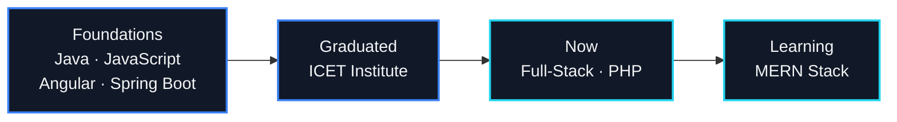

<h1>Hi, I'm Chathupa Chamika 👋</h1>

  
  
  
  

  <a href="#about-me">About</a> ·
  <a href="#tech-stack">Tech Stack</a> ·
  <a href="#featured-projects">Projects</a> ·
  <a href="#github-dashboard">Dashboard</a> ·
  <a href="#contact-me">Contact</a>

## About Me

> Recent graduate of **ICET Institute**, working as a **freelancer** and growing into a well-rounded **full-stack developer**.

- 🎓 **Education:** recent graduate of ICET Institute
- 🔭 **Current focus:** full-stack development and **PHP**
- 🌱 **Currently learning:** the **MERN stack** (MongoDB, Express.js, React, Node.js)
- ☕ **Comfortable with:** Java, JavaScript, Angular and Spring Boot
- 🌐 **Portfolio:** [portfolio20041119.s3-website.eu-north-1.amazonaws.com](http://portfolio20041119.s3-website.eu-north-1.amazonaws.com/)
- 📫 **Reach me:** [Chathupachamika765@gmail.com](mailto:Chathupachamika765@gmail.com)

### Development Journey

> MERN is an addition to my toolkit, not a replacement: PHP and the MERN stack sit side by side in my full-stack path.

## Tech Stack

**Programming Languages** 

**Frontend Development** 

**Backend Development** 

**Frameworks &amp; Libraries** 

**Databases** 

**Cloud &amp; Deployment** 

**Development Tools** 

**Version Control** 

## Featured Projects

<!--
  TODO: replace REPLACE_WITH_REPO_NAME with your real repository names (exact spelling).
  Add or remove cards as needed. Keep 2 per row for clean mobile rendering.
-->

  
  
  
  

## GitHub Dashboard

  
  
  
  

<!-- OPTIONAL: contribution snake. Needs .github/workflows/snake.yml to run once first. -->

  

## Contact Me

  
  
  
  
   
  
  
  

### Support My Work

  
  

 

  
    
  <code>build · learn · ship</code>

