<!-- ═══════════════════════════ HERO ═══════════════════════════ -->
<div align="center">



<h1>Hi, I'm Chathupa Chamika 👋</h1>

<a href="https://github.com/Chathupachamika">
  
</a>

<p>
  
  
  
</p>

<p>
  <a href="http://portfolio20041119.s3-website.eu-north-1.amazonaws.com/"></a>
  <a href="mailto:Chathupachamika765@gmail.com"></a>
  <a href="https://www.linkedin.com/in/chathupa-chamika-/"></a>
  
</p>

</div>


<!-- ═══════════════════════════ ABOUT ═══════════════════════════ -->
## 🧑‍💻 About Me

```js
// about.js
const chathupa = {
  education: "Recent graduate — ICET Institute",
  currentlyLearning: "MERN Stack",
  currentFocus: ["Full-stack development", "PHP"],
  familiarWith: ["Java", "JavaScript", "Angular", "Spring Boot"],
  motto: "Building ideas into software",
};
```

I'm a developer who enjoys turning ideas into working web applications. I'm growing across the **MERN stack** and **PHP** side by side — two parallel paths toward becoming a well-rounded full-stack developer.

<table>
  <tr>
    <td width="33%" valign="top">

**🎯 Current Focus**
- Full-stack application development
- PHP-based development
- Modern web application architecture

</td>
    <td width="33%" valign="top">

**🔭 Currently Exploring**
- MERN stack (MongoDB, Express, React, Node.js)
- Laravel and PHP back ends
- Modern tooling and cloud deployment

</td>
    <td width="33%" valign="top">

**💡 Philosophy**
- Learn by building
- Write code that's readable
- Keep improving, one project at a time

</td>
  </tr>
</table>


<!-- ═══════════════════════════ TECH STACK ═══════════════════════════ -->
## 🧰 Tech Stack

<details open>
<summary><b>&gt;_ languages</b></summary>
<br/>
<p>
  
</p>
</details>

<details open>
<summary><b>&gt;_ frontend</b></summary>
<br/>
<p>
  
</p>
</details>

<details open>
<summary><b>&gt;_ backend</b></summary>
<br/>
<p>
  
</p>
</details>

<details open>
<summary><b>&gt;_ frameworks &amp; libraries</b></summary>
<br/>
<p>
  
</p>
</details>

<details open>
<summary><b>&gt;_ databases</b></summary>
<br/>
<p>
  
</p>
</details>

<details open>
<summary><b>&gt;_ cloud &amp; deployment</b></summary>
<br/>
<p>
  
</p>
</details>

<details open>
<summary><b>&gt;_ dev tools</b></summary>
<br/>
<p>
  
</p>
</details>

<details open>
<summary><b>&gt;_ version control</b></summary>
<br/>
<p>
  
</p>
</details>


<!-- ═══════════════════════════ FEATURED PROJECTS ═══════════════════════════ -->
## 🚀 Featured Projects

> **Setup:** replace `REPO_NAME_1`, `REPO_NAME_2`, `REPO_NAME_3` below with the names of your real repositories (and delete this note). Cards stay empty until you do.

<div align="center">
<table>
  <tr>
    <td align="center" width="50%">
      <a href="https://github.com/Chathupachamika/REPO_NAME_1">
        
      </a>
    </td>
    <td align="center" width="50%">
      <a href="https://github.com/Chathupachamika/REPO_NAME_2">
        
      </a>
    </td>
  </tr>
  <tr>
    <td align="center" colspan="2">
      <a href="https://github.com/Chathupachamika/REPO_NAME_3">
        
      </a>
    </td>
  </tr>
</table>
</div>

<p align="center">
  <a href="https://github.com/Chathupachamika?tab=repositories"></a>
</p>


<!-- ═══════════════════════════ WORKSPACE ═══════════════════════════ -->
## 🖥️ Developer Workspace

<p align="center">
  
</p>


<!-- ═══════════════════════════ JOURNEY ═══════════════════════════ -->
## 🧭 Learning Roadmap

```text
 ● Foundation ───────── ● Building ──────────────── ● Exploring
   Java · JavaScript      Full-stack development      MERN stack
   Angular · Spring Boot  Web applications            PHP · Laravel
   HTML · CSS · SQL/NoSQL Real projects               Cloud with AWS
```

<sub>A thematic roadmap of direction — not a dated timeline.</sub>


<!-- ═══════════════════════════ ANALYTICS ═══════════════════════════ -->
## 📊 GitHub Analytics

<div align="center">
  
  
</div>

<div align="center">
  
</div>

<div align="center">
  
</div>

<!-- Optional: contribution snake. Shows only after the workflow has run once. -->
<div align="center">
  <picture>
    <source media="(prefers-color-scheme: dark)" srcset="https://raw.githubusercontent.com/Chathupachamika/Chathupachamika/output/github-contribution-grid-snake-dark.svg"/>
    <source media="(prefers-color-scheme: light)" srcset="https://raw.githubusercontent.com/Chathupachamika/Chathupachamika/output/github-contribution-grid-snake.svg"/>
    
  </picture>
</div>


<!-- ═══════════════════════════ CONTACT ═══════════════════════════ -->
## 📬 Contact Me

<div align="center">

<a href="http://portfolio20041119.s3-website.eu-north-1.amazonaws.com/"></a>
<a href="mailto:Chathupachamika765@gmail.com"></a>

<br/><br/>

<a href="https://www.linkedin.com/in/chathupa-chamika-/"></a>
<a href="https://twitter.com/chathupachamika"></a>
<a href="https://web.facebook.com/chathupa.chamika.7"></a>
<a href="https://instagram.com/chathupachamika"></a>
<a href="https://wa.me/+94754278741"></a>

</div>

### ☕ Support My Work

<div align="center">
  <a href="https://www.buymeacoffee.com/chathupache"></a>
  <a href="https://ko-fi.com/chathupachamika"></a>
</div>

<!-- ═══════════════════════════ FOOTER ═══════════════════════════ -->
<p align="center">
  
  <br/>
  <a href="#top"><sub>⬆ back to top</sub></a>
</p>
