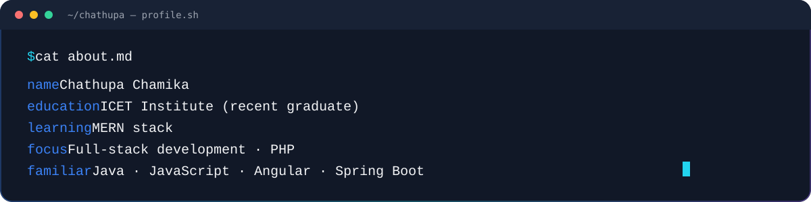
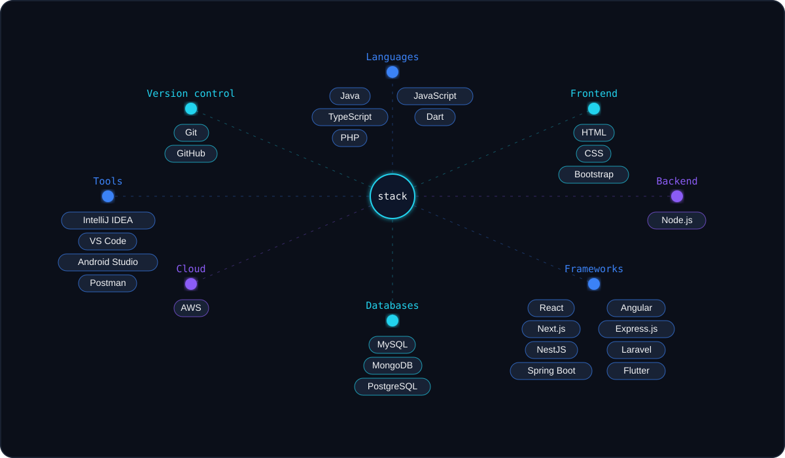
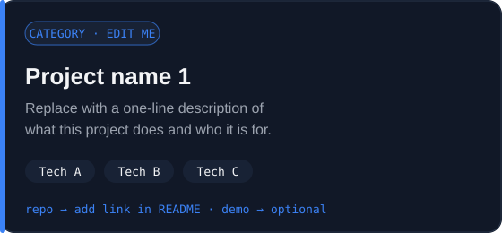
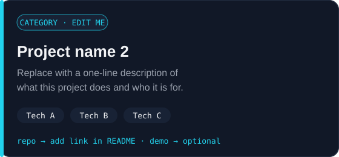
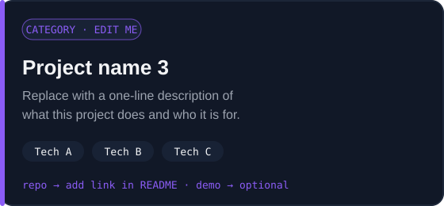
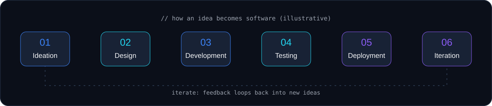
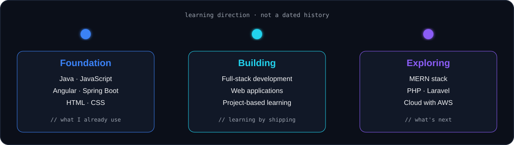

<!-- ═════════════════════════ HERO ═════════════════════════ -->

<picture>
  <source media="(prefers-color-scheme: light)" srcset="./assets/hero-banner-light.svg"/>
  <source media="(prefers-color-scheme: dark)" srcset="./assets/hero-banner.svg"/>
  
</picture>

<h1>Hi, I'm Chathupa Chamika 👋</h1>

  
  
  

  

  

<code>&gt; Building ideas into software</code>

<!-- ═════════════════════════ ABOUT ═════════════════════════ -->
## 🧑‍💻 About Me

  

I enjoy turning ideas into working web applications and learning by building them. **Full-stack development** and **PHP** are my current focus, and I'm learning the **MERN stack** alongside them — parallel paths, not replacements for each other.

**🎯 Current focus** — Full-stack application development · PHP-based development · modern web application architecture

**🔭 Learning direction** — MERN stack (MongoDB, Express, React, Node.js) · Laravel · cloud deployment with AWS

**🧭 Development principles**
- **Learn by building** — projects teach faster than tutorials
- **Write maintainable code** — readable today, changeable tomorrow
- **Design with users in mind** — interfaces should feel obvious
- **Improve through experimentation** — iterate, measure, refine

<!-- ═════════════════════════ WORKSPACE ═════════════════════════ -->
## 🖥️ Developer Workspace

  

<!-- ═════════════════════════ TECH ═════════════════════════ -->
## 🧰 Technology Constellation

  

<b>&gt;_ icon view (same technologies)</b>

 

| Category | Technologies |
|:--|:--|
| **Languages** |  |
| **Frontend** |  |
| **Backend** |  |
| **Frameworks** |  |
| **Databases** |  |
| **Cloud** |  |
| **Tools** |  |
| **Version control** |  |

<!-- ═════════════════════════ PROJECTS ═════════════════════════ -->
## 🚀 Featured Projects

> **Edit me:** these three cards are placeholders. Open each `assets/project-card-N.svg`, change the category, name, description and tech chips, then point each link below at the real repository (and add a live-demo link only once it is deployed). Delete this note afterwards.

  
  

<!-- ═════════════════════════ PIPELINE ═════════════════════════ -->
## ⚙️ From Idea to Deployment

  

<b>Text version (for small screens)</b>

1. **Ideation** → 2. **Design** → 3. **Development** → 4. **Testing** → 5. **Deployment** → 6. **Iteration**

This illustrates how I think about building software — it is not a claim that every project follows it exactly.

<!-- ═════════════════════════ ROADMAP ═════════════════════════ -->
## 🧭 Learning Roadmap

  

<!-- ═════════════════════════ ANALYTICS ═════════════════════════ -->
## 📊 GitHub Analytics

  
  

  

  

Third-party widgets can be rate-limited or briefly offline; the rest of the page does not depend on them.

<!-- Optional snake: appears only after the "Generate Contribution Snake" workflow has run once. -->

  <picture>
    <source media="(prefers-color-scheme: dark)" srcset="https://raw.githubusercontent.com/Chathupachamika/Chathupachamika/output/github-contribution-grid-snake-dark.svg"/>
    <source media="(prefers-color-scheme: light)" srcset="https://raw.githubusercontent.com/Chathupachamika/Chathupachamika/output/github-contribution-grid-snake.svg"/>
    
  </picture>

<!-- ═════════════════════════ CONTACT ═════════════════════════ -->
## 📬 Contact Me

  

### ☕ Support My Work

  
  

<!-- ═════════════════════════ FOOTER ═════════════════════════ -->

  <picture>
    <source media="(prefers-color-scheme: light)" srcset="./assets/footer-banner-light.svg"/>
    <source media="(prefers-color-scheme: dark)" srcset="./assets/footer-banner.svg"/>
    
  </picture>
   
  <a href="#top">⬆ back to top</a>

